## Field boundaries and geographic representations {#cover .full .tg-light}

```{=html}
<div class="tg-cover"><div class="tg-cover-copy"><p class="eyebrow">UT Austin · Causal ML &amp; EO for Social Sci<br>November 10, 2026</p><h1>Field boundaries and<br>geographic representations</h1><p class="cover-subtitle">Fields of the World and MIND</p><p class="presenter">Isaac Corley<br><span>Director of AI/ML Research, Taylor Geospatial</span></p></div><div class="cover-fields">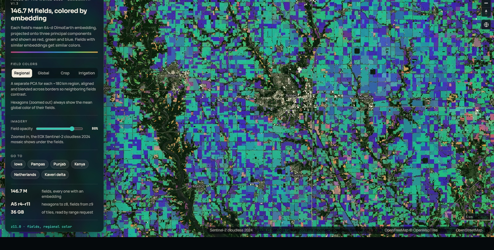</div></div>
```


## Isaac Corley {#introduction .tg-light .visual-slide .context-slide}

```{=html}
<div class="intro-layout"><div><h3>Director of AI/ML Research</h3><p>Taylor Geospatial</p><h3>TorchGeo co-creator and maintainer</h3><p>Since 2021. The most-downloaded geospatial deep learning library on PyPI (3.5M downloads, 4.2k GitHub stars)</p></div></div>
```


## Industry and academia, 2015–2026 {#career .tg-light .visual-slide .context-slide}

```{=html}
<div class="career-layout">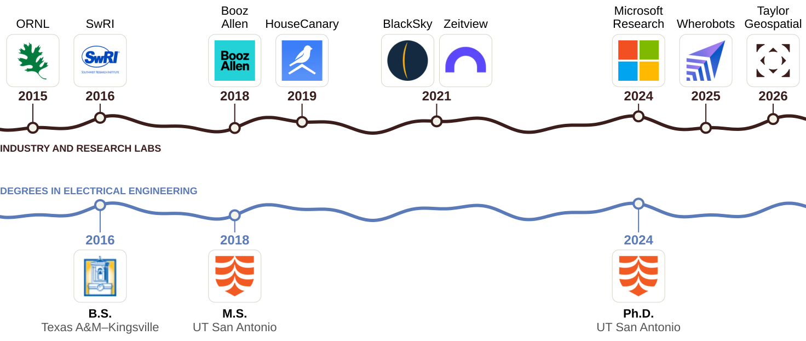</div>
```


## Today's talk {#scope .tg-light .visual-slide .context-slide}

```{=html}
<div class="scope-pair"><div>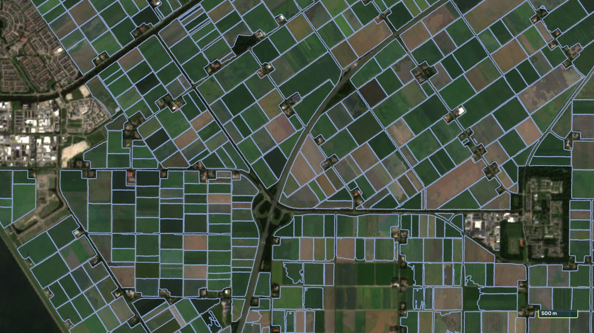<h3>Fields of the World</h3><p>Annual field boundaries from satellite imagery</p><p>Training data, global inference and geometry processing</p></div><div>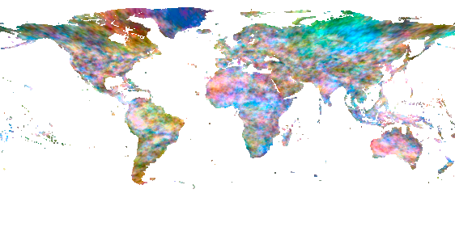<h3>MIND</h3><p>Geographic features from coordinates</p><p>Spatial scale and evaluation in held-out regions</p></div></div>
```


## From the planet to a single field {#ftw-zoom .full .tg-dark}

```{=html}
<div class="film-slide"><div class="motion-only">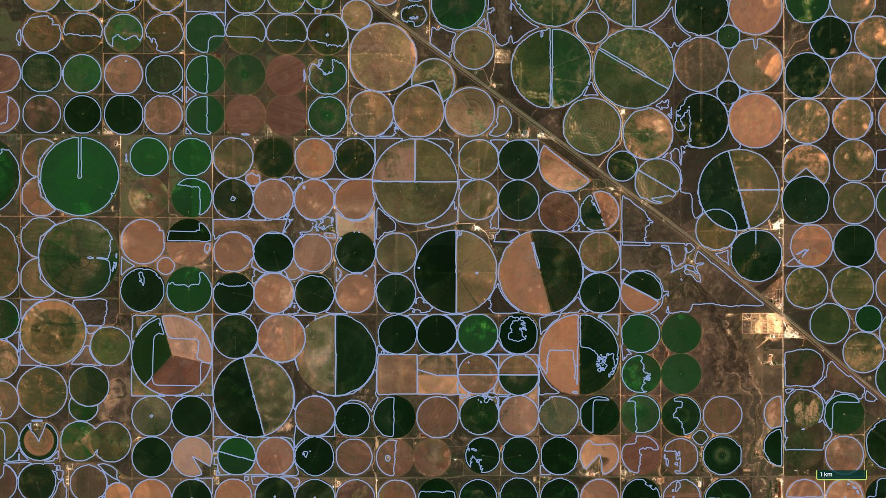<video muted playsinline preload="metadata" poster="assets/motion/ftw-zoom-poster.jpg"><source src="assets/motion/ftw-zoom.mp4" type="video/mp4"></video></div><div class="film-label"><h2>From the planet to a single field</h2><p>FTW-2E preview · 2025 field polygons · Q3 Sentinel-2 mosaic</p></div></div><p class="source-footnote"><a href="https://research.taylorgeospatial.org/global-ftw-2e/">FTW-2E · EOX s2cloudless · © OpenStreetMap</a></p>
```


## Global field boundaries {#ftw-gallery .tg-light .visual-slide}

```{=html}
<div class="visual-gallery gallery-eight"><figure><div class="motion-only">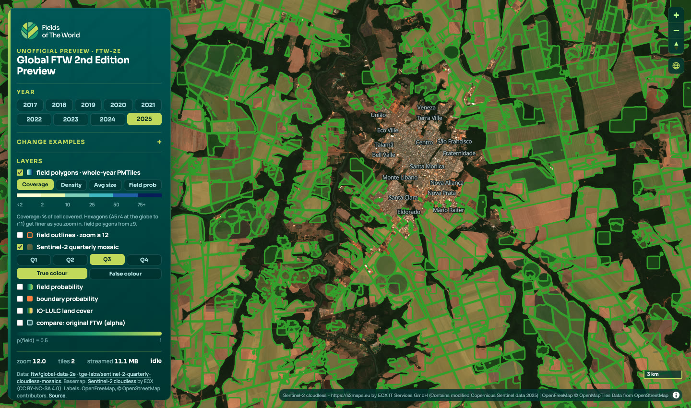<video muted loop playsinline controls preload="metadata" poster="assets/motion/ftw-poster.jpg"><source src="assets/motion/ftw.mp4" type="video/mp4"></video></div><figcaption>Sorriso, Brazil</figcaption></figure><figure><figcaption>Flevoland, Netherlands</figcaption></figure><figure>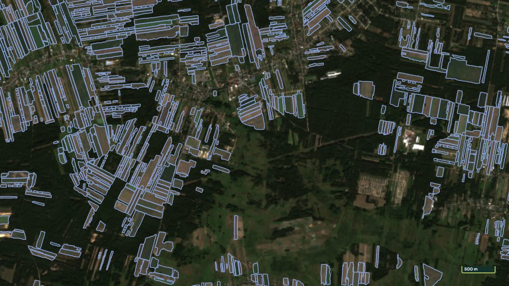<figcaption>Mazovia, Poland</figcaption></figure><figure>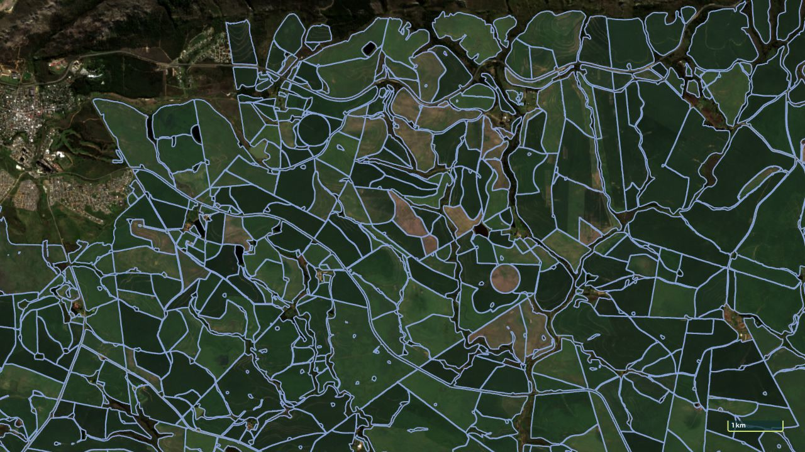<figcaption>Overberg, South Africa</figcaption></figure><figure>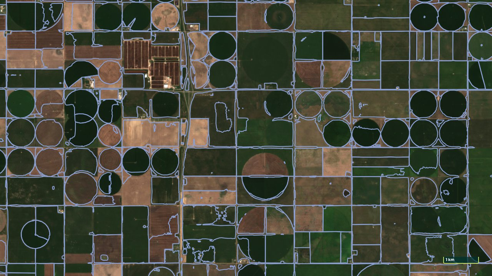<figcaption>Haskell County, Kansas</figcaption></figure><figure>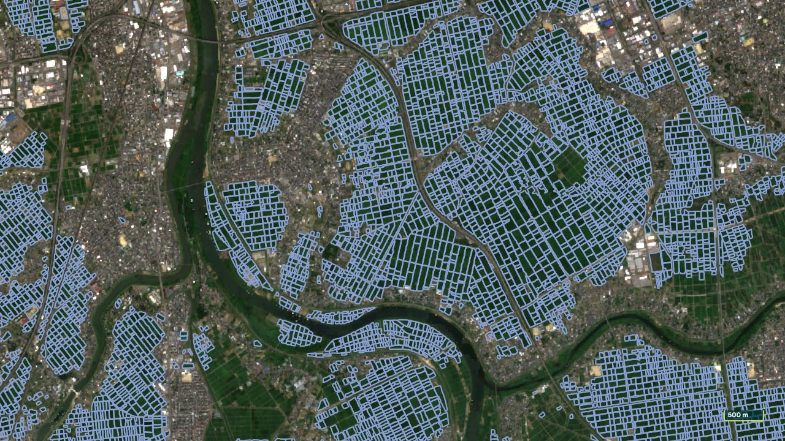<figcaption>Niigata, Japan</figcaption></figure><figure>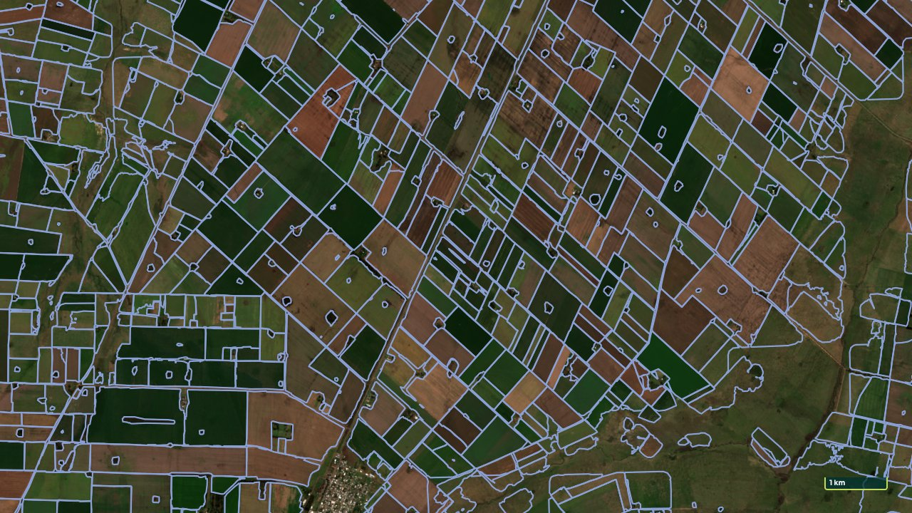<figcaption>Pergamino, Argentina</figcaption></figure><figure>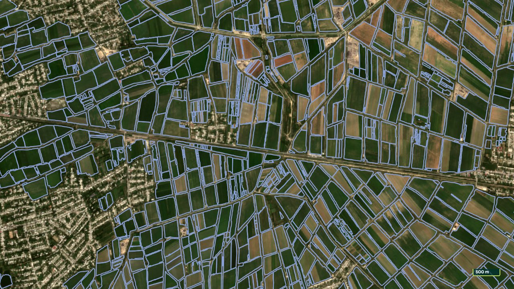<figcaption>Fergana Valley, Uzbekistan</figcaption></figure></div><p class="visual-caption">FTW 2nd edition preview · 2025 predictions · Sentinel-2 Q3 imagery</p><p class="source-footnote"><a href="https://source.coop/ftw/global-data-2e">Source Cooperative</a></p>
```


## Global FTW 2nd edition preview {#ftw-2e-demo .tg-light .visual-slide .demo-slide}

```{=html}
<div class="demo-embed" data-src="https://research.taylorgeospatial.org/global-ftw-2e/#year=2025&q=Q3&mode=tc&pm=1&pmm=coverage">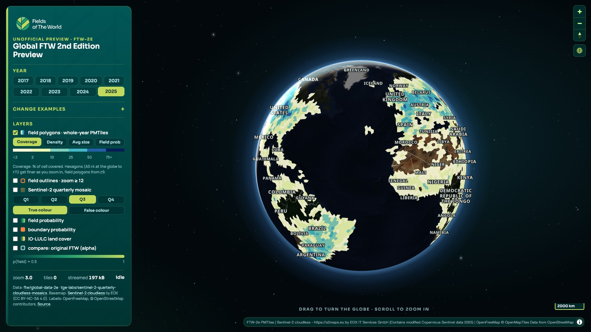<iframe title="Global FTW 2nd Edition preview" allow="fullscreen" referrerpolicy="no-referrer"></iframe></div><p class="visual-caption">Live demo · 2017–2025 field polygons as PMTiles over quarterly Sentinel-2 mosaics · drag to turn, scroll to zoom</p><p class="source-footnote"><a href="https://research.taylorgeospatial.org/global-ftw-2e/">research.taylorgeospatial.org/global-ftw-2e</a></p>
```


## Al-Jawf, Saudi Arabia {#saudi-change .tg-light .visual-slide}

```{=html}
<div class="visual-gallery gallery-pair"><figure>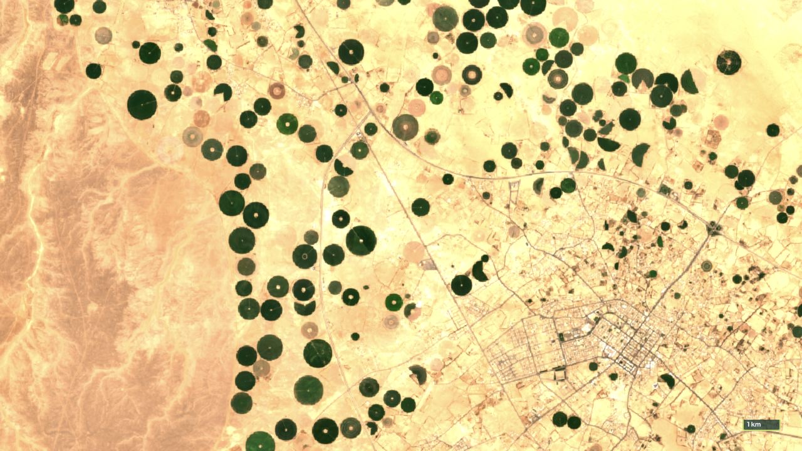<figcaption>2018 Q3</figcaption></figure><figure>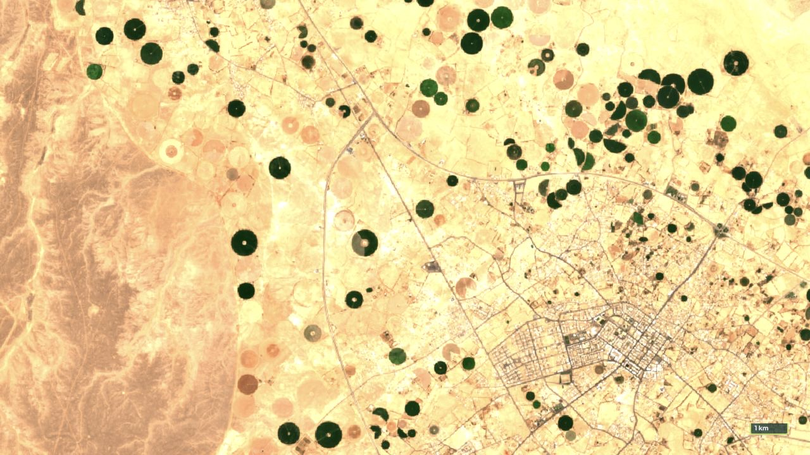<figcaption>2025 Q3</figcaption></figure></div><p class="visual-caption">Fewer green pivots in the later mosaic; the cause is not established.</p><p class="source-footnote"><a href="https://research.taylorgeospatial.org/global-ftw-2e/">Copernicus Sentinel-2</a></p>
```


## New field blocks {#change-new-fields .tg-light .visual-slide}

```{=html}
<div class="change-pair"><figure><h3>Matopiba, Brazil</h3><div class="motion-only">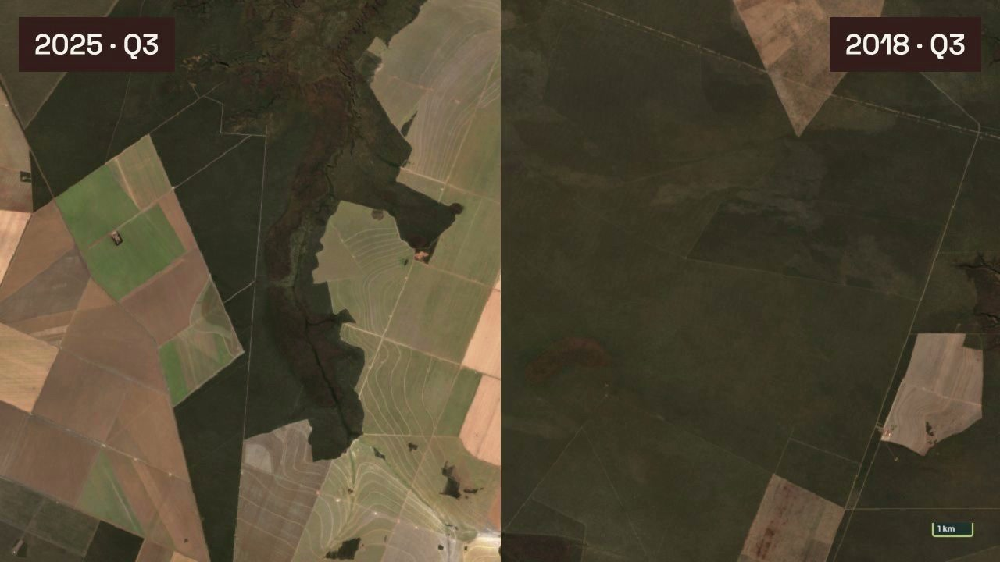<video muted loop playsinline controls preload="metadata" poster="assets/motion/matopiba-change-poster.jpg"><source src="assets/motion/matopiba-change.mp4" type="video/mp4"></video></div><figcaption>2018 → 2025 · Q3</figcaption></figure><figure><h3>Masindi, Uganda</h3><div class="motion-only">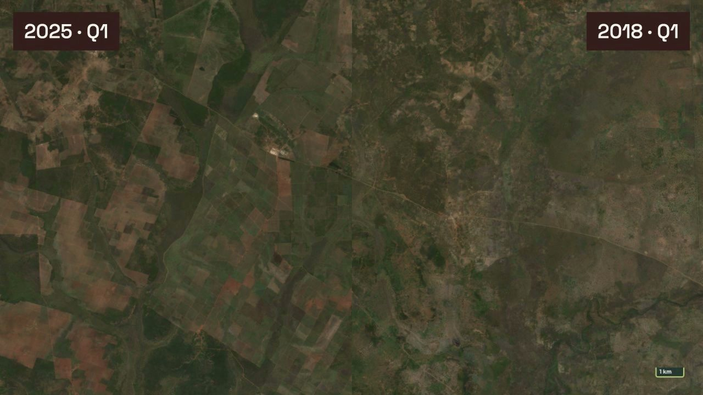<video muted loop playsinline controls preload="metadata" poster="assets/motion/masindi-change-poster.jpg"><source src="assets/motion/masindi-change.mp4" type="video/mp4"></video></div><figcaption>2018 → 2025 · Q1</figcaption></figure></div><p class="visual-caption">New field patterns in the later imagery.</p><p class="source-footnote"><a href="https://github.com/isaaccorley/cng-mapping-digital-public-goods/blob/f7517e1be8466bc4a4793f29e03b322e95ccaa2f/MEDIA.md">CNG talk captures · Copernicus Sentinel-2 · RGB imagery only</a></p>
```


## New fields across valley floors {#change-valleys .tg-light .visual-slide}

```{=html}
<div class="change-pair"><figure><h3>Ili Valley, China</h3><div class="motion-only">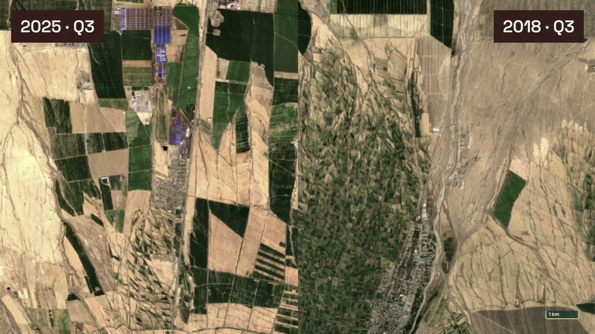<video muted loop playsinline controls preload="metadata" poster="assets/motion/ili-change-poster.jpg"><source src="assets/motion/ili-change.mp4" type="video/mp4"></video></div><figcaption>2018 → 2025 · Q3</figcaption></figure><figure><h3>Kura lowland, Azerbaijan</h3><div class="motion-only">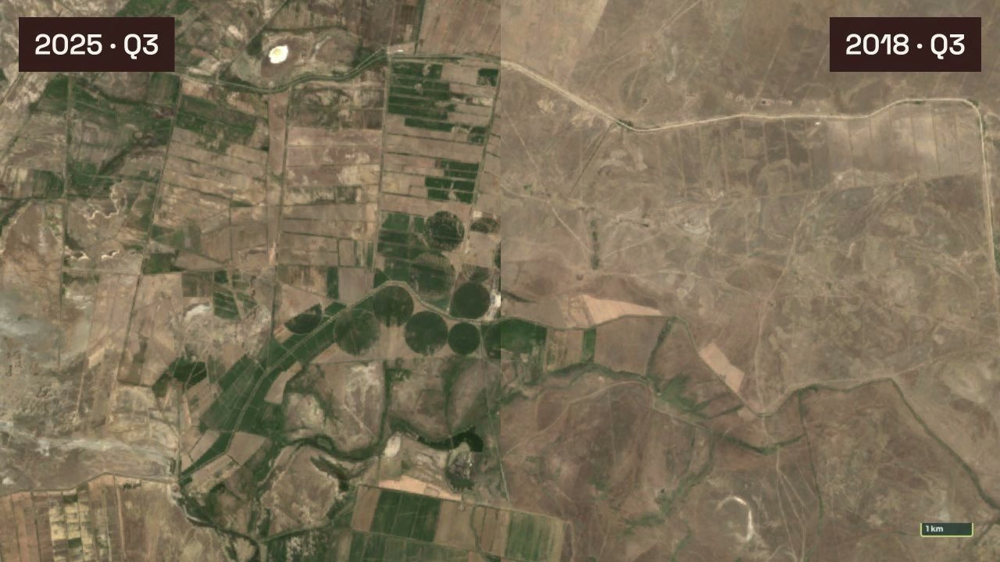<video muted loop playsinline controls preload="metadata" poster="assets/motion/kura-change-poster.jpg"><source src="assets/motion/kura-change.mp4" type="video/mp4"></video></div><figcaption>2018 → 2025 · Q3</figcaption></figure></div><p class="visual-caption">Field patterns cover more ground in the later images; water use and causes are not measured here.</p><p class="source-footnote"><a href="https://github.com/isaaccorley/cng-mapping-digital-public-goods/blob/f7517e1be8466bc4a4793f29e03b322e95ccaa2f/MEDIA.md">CNG talk captures · Copernicus Sentinel-2 · RGB imagery only</a></p>
```


## Changing field layout in West Bahia, Brazil {#change-bahia .tg-light .visual-slide}

```{=html}
<div class="change-single motion-only">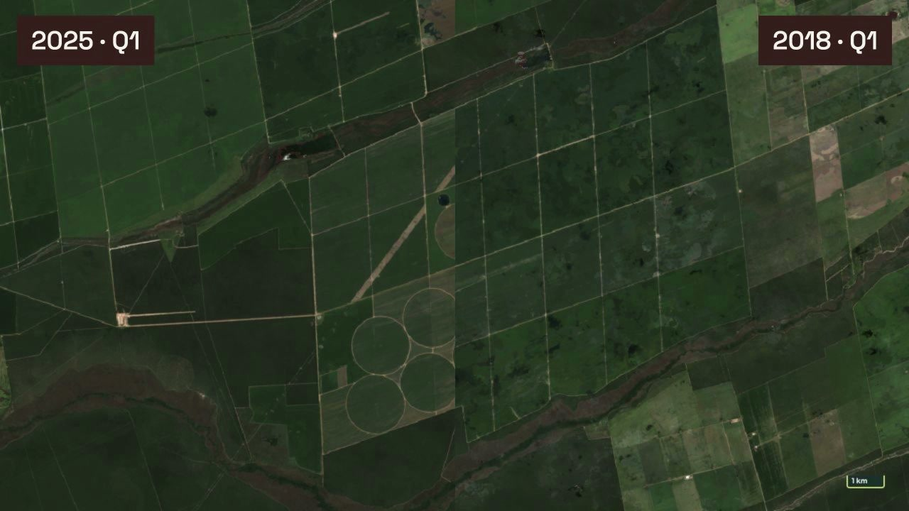<video muted loop playsinline controls preload="metadata" poster="assets/motion/bahia-layout-change-poster.jpg"><source src="assets/motion/bahia-layout-change.mp4" type="video/mp4"></video></div><p class="visual-caption">2018 → 2025 · Q1 · Rectangular fields give way to center pivots while the land remains agricultural.</p><p class="source-footnote"><a href="https://github.com/isaaccorley/cng-mapping-digital-public-goods/blob/f7517e1be8466bc4a4793f29e03b322e95ccaa2f/MEDIA.md">CNG talk captures · Copernicus Sentinel-2 · RGB imagery only</a></p>
```


## Nine years of global field boundaries {#ftw-scale .tg-light .visual-slide}

```{=html}
<div class="scale-layout">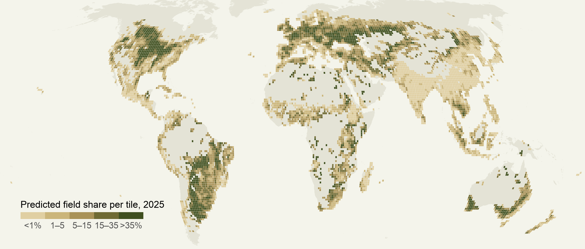<div class="stat-stack"><div class="stat"><b data-count="67197">67,197</b><span>tile-years · 7,467 tiles of 100 km × 9 years</span></div><div class="stat"><b data-count="1.08" data-decimals="2" data-suffix=" M">1.08 M</b><span>Sentinel-2 band COGs streamed into the model</span></div><div class="stat"><b data-count="25.8" data-decimals="1" data-suffix=" TB">25.8 TB</b><span>field and boundary probability COGs at 2.5 m</span></div><div class="stat accent"><b data-count="1.24" data-decimals="2" data-suffix=" B">1.24 B</b><span>field polygons, 129–147 M per year</span></div><div class="stat"><b data-count="852" data-suffix=" GB">852 GB</b><span>fiboa GeoParquet, plus one PMTiles archive per year</span></div></div></div><p class="fig-caption">Every 100 km tile with cropland, coloured by the share of its pixels predicted as field in 2025.</p><p class="source-footnote"><a href="https://source.coop/ftw/global-data-2e">Source Cooperative</a></p>
```


## Who has field data and who uses it {#field-data-uses .tg-light .visual-slide .context-slide}

```{=html}
<div class="uses-layout"><figure class="uses-wide">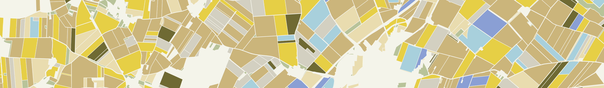<figcaption>France publishes every field and its crop each year. Most countries publish none.</figcaption></figure><div class="uses-row"><figure>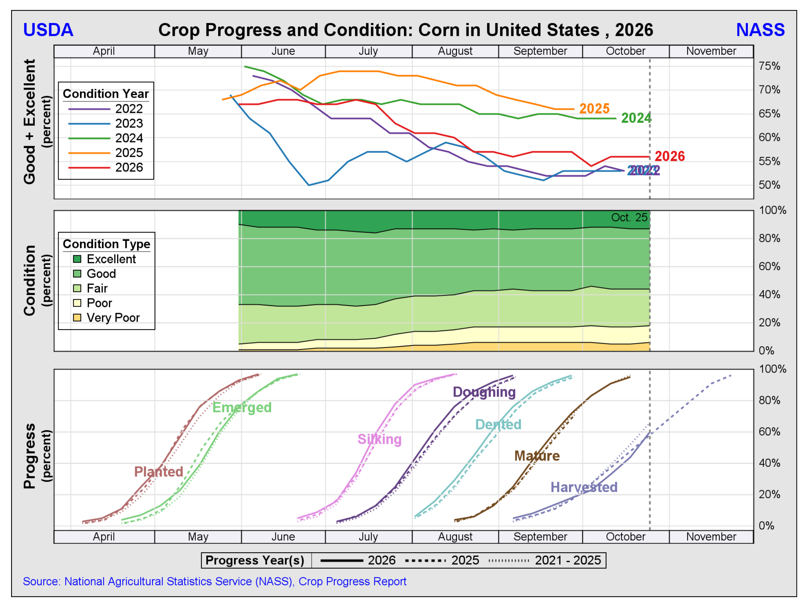<figcaption><b>Markets and food security</b><span>USDA Crop Progress, US corn, 2026</span></figcaption></figure><figure>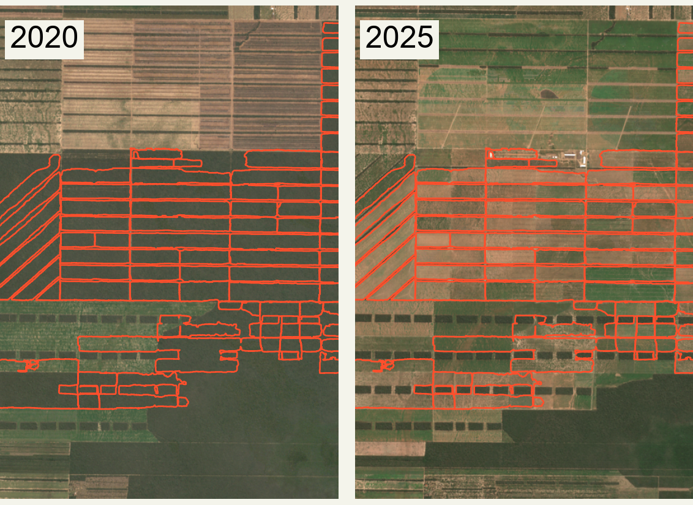<figcaption><b>EU Deforestation Regulation</b><span>Bolivia: fields on forest cleared after 2020</span></figcaption></figure><figure>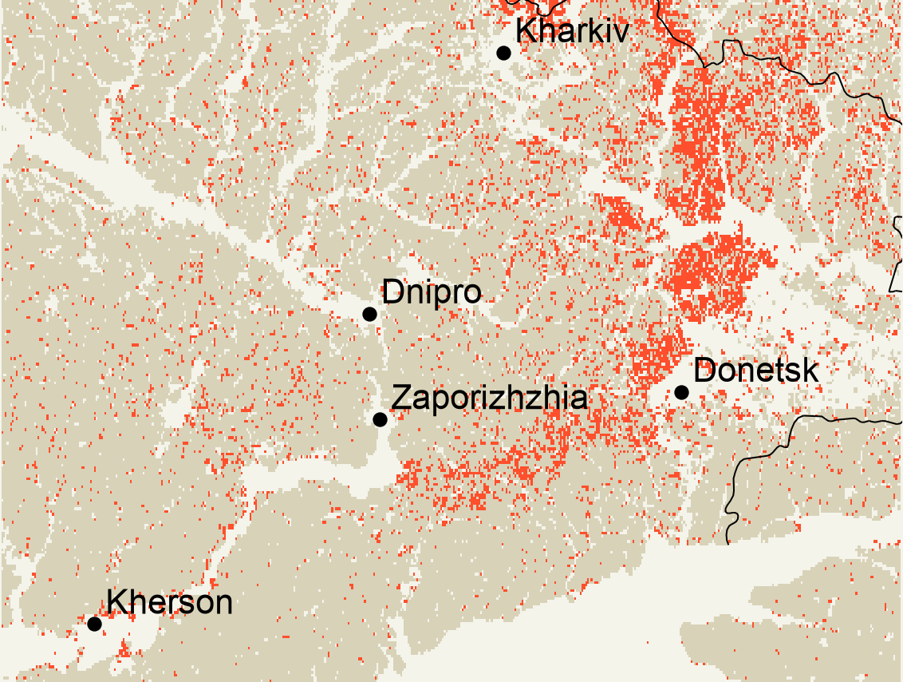<figcaption><b>Farmland in war</b><span>Ukraine: 2021 fields not detected in 2025</span></figcaption></figure></div></div><p class="source-footnote">RPG 2024 · USDA NASS · Hansen/UMD/Google/USGS/NASA · FTW-2E · Copernicus Sentinel-2</p>
```


## Training labels for field-boundary mapping {#labels .tg-light}

```{=html}
<div class="lecture-columns labels-columns"><div><p>Each labeled example pairs satellite images with reference field boundaries.</p><p><strong>Semantic mask:</strong><br>each pixel gets a class.</p><p><strong>Instance mask:</strong><br>each field gets its own identity.</p></div><div>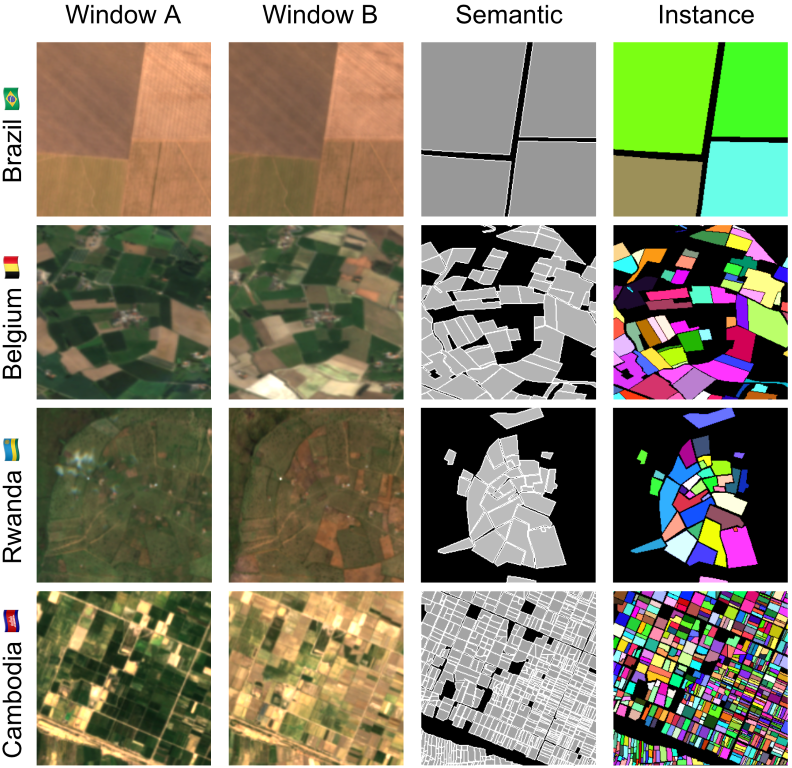</div></div><p class="source-footnote"><a href="https://arxiv.org/html/2409.16252v2">FTW paper · CC BY 4.0</a></p>
```


## Collecting field data for FTW v2 {#ftw-v2-data .tg-light .visual-slide .context-slide}

```{=html}
<div class="scale-layout catalog-layout">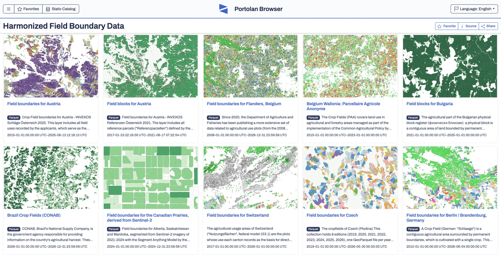<div class="stat-stack"><div class="stat accent"><b data-count="69">69</b><span>collections from 29 countries, harmonized to the fiboa schema</span></div><div class="stat"><b data-count="145.7" data-decimals="1" data-suffix=" M">145.7 M</b><span>crop fields in the newest edition of 53 collections</span></div><div class="stat"><b data-count="773" data-suffix=" M">773 M</b><span>field records across 339 yearly editions</span></div><div class="stat"><b data-count="19.4" data-decimals="1" data-suffix=" M">19.4 M</b><span>field blocks (reference parcels) in 16 more collections</span></div></div></div><p class="fig-caption">Next step for the benchmark: government parcel registers and research datasets, republished as GeoParquet and PMTiles.</p><p class="source-footnote"><a href="https://browser.portolan-sdi.org/#/external/data.source.coop/ftw/harmonized-field-data/catalog.json">Portolan Browser</a></p>
```


## Published field-boundary outputs {#outputs .tg-light}

```{=html}
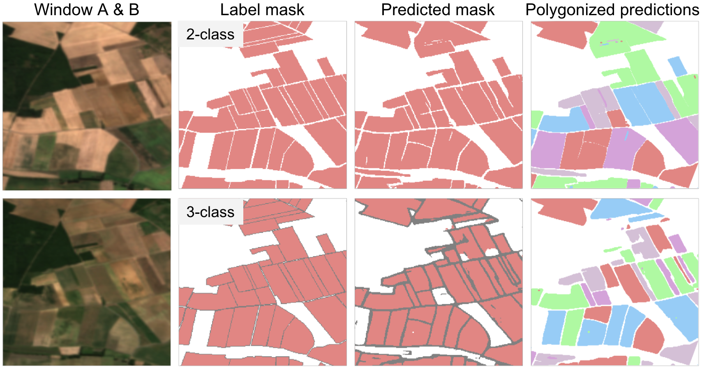<p class="slide-caption">The three-class example separates adjacent fields that merge in the two-class output.</p><p class="source-footnote"><a href="https://arxiv.org/html/2409.16252v2">FTW paper · CC BY 4.0</a></p>
```


## Comparing 18 field-boundary models {#prue .tg-light .visual-slide .context-slide}

```{=html}
<div class="prue-layout"><div class="prue-table">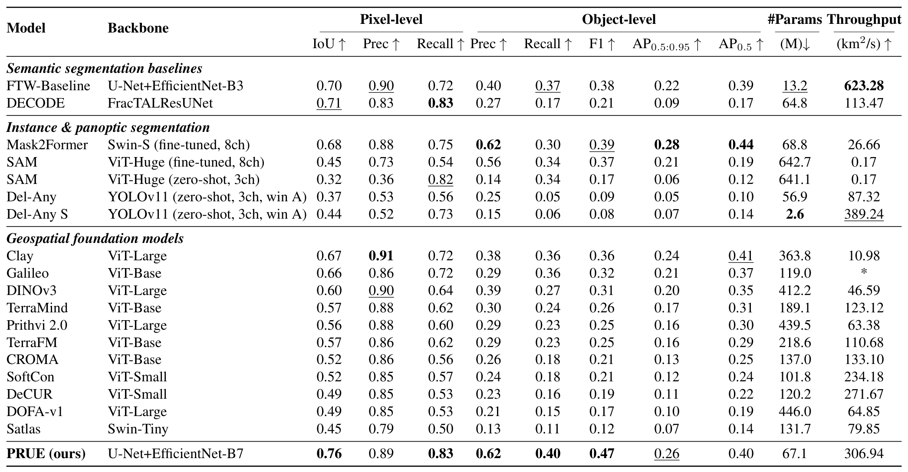<span class="row-mark" style="top:16.1%;height:3.6%"></span><span class="row-mark" style="top:93.5%;height:5.2%"></span></div><div><p><b>U-Net + EfficientNet leads.</b> PRUE (B7) has the best IoU, 0.76, and object F1, 0.47; the B3 baseline is the fastest.</p><p><b>Foundation-model encoders</b> reach IoU 0.45–0.67 with 100–450 M parameters.</p><p><b>Fine-tuned SAM:</b> 643 M parameters and 0.17 km²/s, against 307 km²/s for PRUE.</p></div></div><p class="source-footnote"><a href="https://openaccess.thecvf.com/content/CVPR2026/html/Muhawenayo_PRUE_A_Practical_Recipe_for_Field_Boundary_Segmentation_at_Scale_CVPR_2026_paper.html">Muhawenayo et al., CVPR 2026</a></p>
```


## Annual model inputs {#annual-inputs .tg-light .visual-slide .context-slide}

```{=html}
<div class="inputs-layout"><div class="quarter-grid"><figure>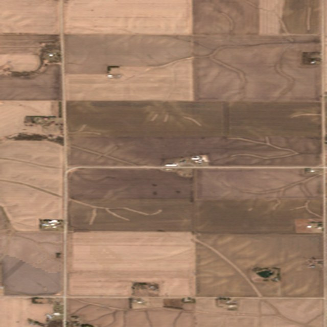<figcaption>Q1</figcaption></figure><figure>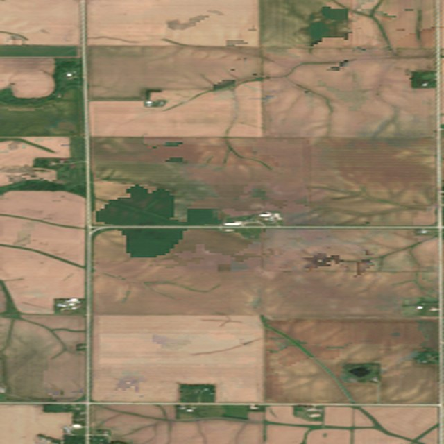<figcaption>Q2</figcaption></figure><figure>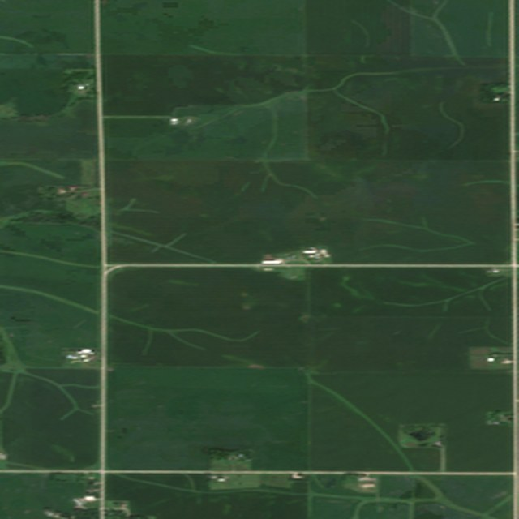<figcaption>Q3</figcaption></figure><figure>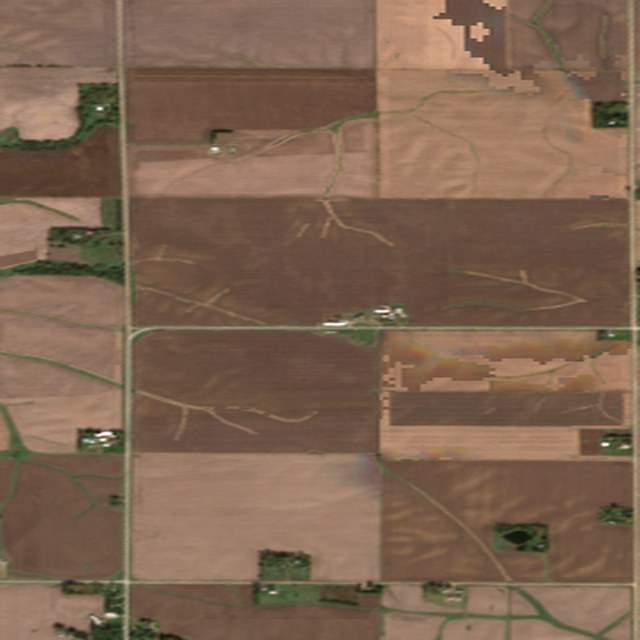<figcaption>Q4</figcaption></figure></div><div class="model-col"><p class="arrow">→</p><h3>4 quarters × RGBN</h3><p>16 bands per tile-year, from the official quarterly cloudless Sentinel-2 mosaics</p><p>U-Net, EfficientNet-B3 encoder, trained on FTW-Q</p><p>One global pass per year, 2017–2025</p><p class="arrow">→</p></div><div class="output-stack"><figure>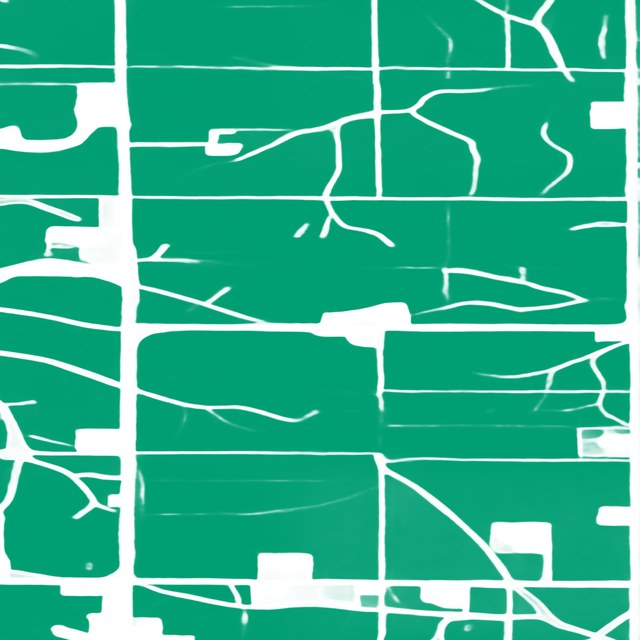<figcaption>p(field)</figcaption></figure><figure>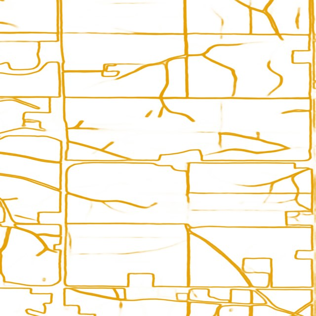<figcaption>p(boundary)</figcaption></figure></div></div><p class="fig-caption">One 4 km window in Marshall County, Iowa, 2025. In Q3 the crop canopy hides most field edges; the other quarters separate them. Outputs on a 2.5 m grid.</p><p class="source-footnote"><a href="https://github.com/taylor-geospatial/global-ftw-2e">global-ftw-2e</a></p>
```


## Producing the global field-boundary dataset {#pipeline .full}

```{=html}
<div class="image-slide">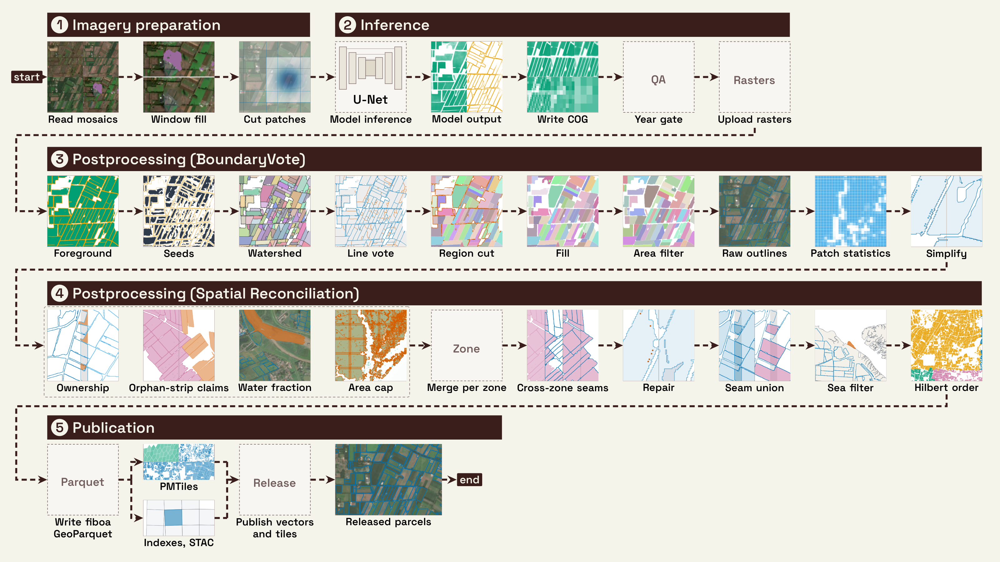</div><p class="source-footnote"><a href="https://github.com/isaaccorley/cng-mapping-digital-public-goods/tree/f7517e1be8466bc4a4793f29e03b322e95ccaa2f/MEDIA.md">Global FTW pipeline</a></p>
```


## Running nine years in two days {#ftw-run .tg-light .visual-slide}

```{=html}
<div class="run-layout">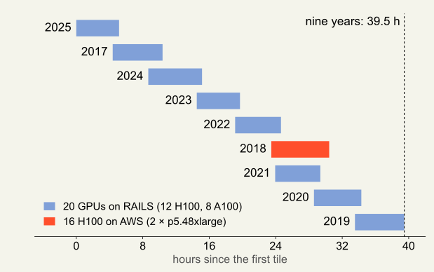<div class="stat-stack"><div class="stat"><b data-count="39.5" data-decimals="1" data-suffix=" h">39.5 h</b><span>GPU inference for all nine years, one year every ~4.9 h</span></div><div class="stat"><b data-count="41" data-suffix=" s">41 s</b><span>per 100 km tile on one H100, streaming its 16 COGs</span></div><div class="stat"><b data-count="28.5" data-decimals="1" data-suffix=" k">28.5 k</b><span>vCPU-hours of BoundaryVote on EC2, up to ~2,200 vCPUs at once</span></div><div class="stat accent"><b>~2 days</b><span>end to end for nine years, including polygons and PMTiles</span></div></div></div><div class="cost-row"><div class="stat accent"><b>~$3.4k</b><span>AWS cash for all nine years (projected), mostly EC2 spot for BoundaryVote; the RAILS GPUs are an allocation</span></div><div class="stat"><b>$0</b><span>to read 188 TB of quarterly mosaics rehosted on Source Cooperative: no egress, and EC2 in us-west-2 beside the bucket, so no cross-region fees</span></div><div class="stat"><b>$0</b><span>to host the outputs: 25.8 TB of rasters, 852 GB of GeoParquet and the PMTiles, on Source Cooperative</span></div></div><p class="source-footnote"><a href="https://github.com/taylor-geospatial/global-ftw-2e/blob/main/docs/reports/pipeline-scaling.md">FTW-2E scaling report</a></p>
```


## BoundaryVote instance extraction {#boundaryvote .tg-light .visual-slide .context-slide}

```{=html}
<div class="bv-layout"><div class="step-grid"><figure class="panel">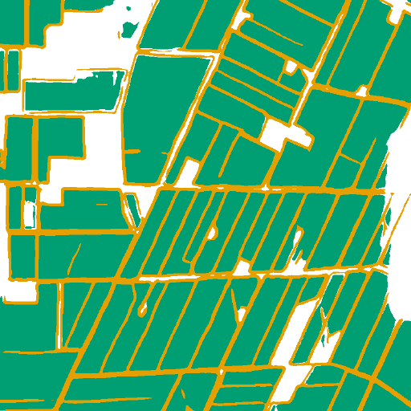<figcaption><b>1</b>Foreground</figcaption></figure><figure class="panel">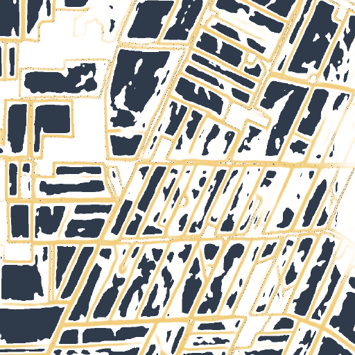<figcaption><b>2</b>Seeds</figcaption></figure><figure class="panel">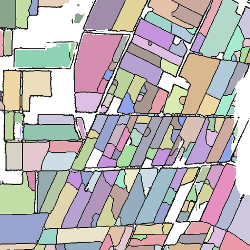<figcaption><b>3</b>Watershed</figcaption></figure><figure class="panel">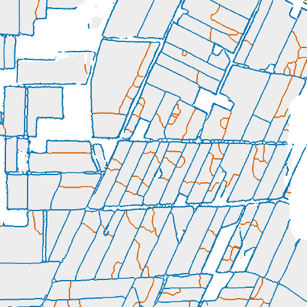<figcaption><b>4</b>Line vote</figcaption></figure><figure class="panel">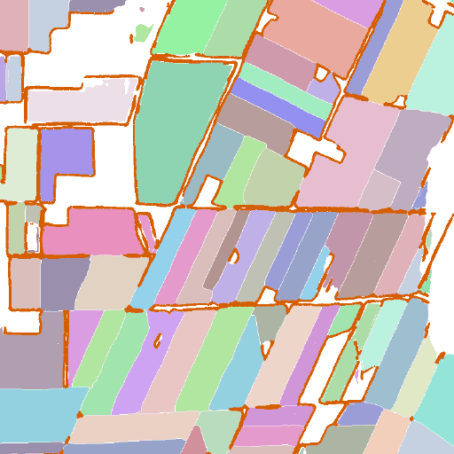<figcaption><b>5</b>Region cut</figcaption></figure><figure class="panel">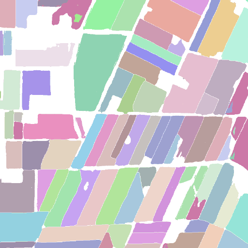<figcaption><b>6</b>Fill from a looser foreground</figcaption></figure><figure class="panel">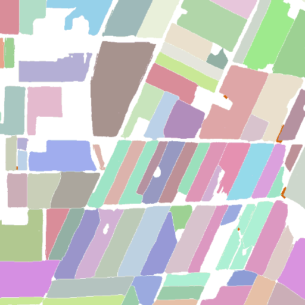<figcaption><b>7</b>Area filter</figcaption></figure><figure class="panel">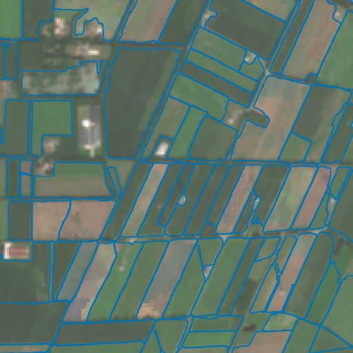<figcaption><b>8</b>Raw outlines</figcaption></figure></div><div><p>Pixel probabilities are not fields: instances need their own extraction step.</p><p>A watershed line survives only if boundary evidence supports it, so adjacent fields stay split.</p><p>One 2 km window of the 2025 run, replayed with <code>fbp.FTW_2E</code>.</p></div></div><p class="source-footnote"><a href="https://github.com/fieldsoftheworld/fbp">fbp</a></p>
```


## Cutting CPU and memory per tile {#geometry-tools .tg-light .visual-slide .context-slide}

```{=html}
<div class="tools-layout"><div>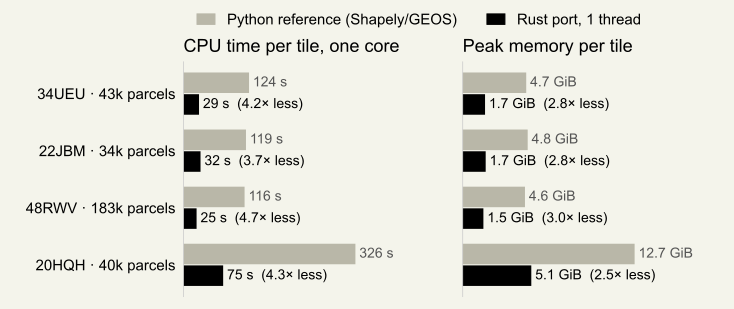<p class="fig-caption">Coverage simplify on the four largest tiles of the parity test. Output is byte-identical at 1, 8 and 32 threads; with 8 threads a tile finishes 10–14× sooner.</p></div><div><p><b>Outlines are the largest AWS cost:</b> 28.5k vCPU-hours. Memory per tile sets how many tiles fit on one box.</p><p><b>GEOS and GDAL run each call on one core</b> and allocate heavily: coverage simplify peaked at 12.7 GiB on one tile.</p><p><b>We port the slow steps to Rust with coding agents.</b> The reference library's output is the test: byte-identical WKB.</p></div></div><p class="source-footnote"><a href="https://github.com/taylor-geospatial/global-ftw-2e/blob/main/rust/coverage-simplify/RESULTS.md">global-ftw-2e · coverage-simplify</a></p>
```


## Polygonizing rasters with contourrs {#contourrs .tg-light .visual-slide .context-slide}

```{=html}
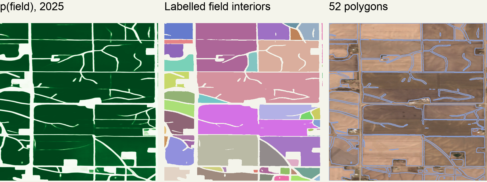<div class="three-notes"><p><b>Raster to polygons</b> in Rust, with Python bindings and Arrow output. No GDAL install.</p><p><b>Same output as rasterio (GDAL):</b> byte-identical WKB on two 2025 tiles, 62,572 parcels, and on this window.</p><p><b>19.9 s vs 28.4 s</b> per tile in the outline step; 7.5× faster than rasterio with Arrow output on a CDL crop.</p></div><p class="source-footnote"><a href="https://github.com/taylor-geospatial/contourrs">contourrs</a></p>
```


## Simplifying polygon coverage with coarsen {#coarsen .tg-light .visual-slide}

```{=html}
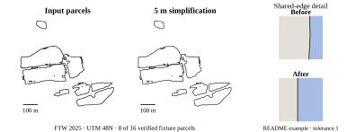<p class="visual-caption">Actual FTW fixture polygons and a shared-edge example · 5 m simplification in local UTM for the parcels</p><div class="three-notes"><p><b>Shared edges are simplified once,</b> so neighbouring fields keep matching boundaries: no gaps or overlaps.</p><p><b>Byte-identical WKB</b> to GEOS 3.13.1 (Shapely 2.1.2) in the parity tests, at one and eight threads.</p><p><b>92–95 s per tile with Shapely, 6.4–9.7 s</b> with eight threads: 260,200 polygons on three FTW tiles.</p></div><p class="source-footnote"><a href="https://research.taylorgeospatial.org/coarsen/performance/">coarsen</a></p>
```


## Publishing a global field product {#distribution .tg-light .visual-slide .context-slide}

```{=html}
<div class="format-row"><figure class="panel">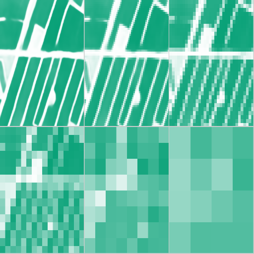<figcaption>Probability rasters<span>Cloud Optimized GeoTIFF, 2.5 m with overviews to 160 m; inspect model output before polygons</span></figcaption></figure><figure class="panel">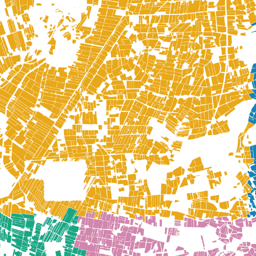<figcaption>Field polygons<span>fiboa GeoParquet per UTM zone, Hilbert-sorted in 8,192-row groups so a bbox query reads few groups</span></figcaption></figure><figure class="panel"><figcaption>Map tiles<span>One PMTiles archive per year: coverage cells to zoom 8, fields from zoom 9</span></figcaption></figure><figure class="panel"><figcaption>Released parcels<span>Nine columns, fiboa-validated, on Source Cooperative over HTTPS range requests</span></figcaption></figure></div><p class="source-footnote"><a href="https://source.coop/ftw/global-data-2e">Source Cooperative</a></p>
```


## Crop type from field embeddings {#ftw-olmoearth-demo .tg-light .visual-slide .demo-slide}

```{=html}
<div class="demo-embed" data-src="https://research.taylorgeospatial.org/ftw-olmoearth/#10.00/42.0000/-93.6000"><iframe title="FTW × OlmoEarth 2025" allow="fullscreen" referrerpolicy="no-referrer"></iframe></div><p class="visual-caption">Live demo · 146.7 M FTW 2025 fields, each with a 64-d OlmoEarth v1.3 embedding · Regional / Global PCA colours, Crop and Irrigation heads</p><p class="source-footnote"><a href="https://research.taylorgeospatial.org/ftw-olmoearth/">research.taylorgeospatial.org/ftw-olmoearth</a></p>
```


## Validation and current limitations {#ftw-limits .tg-light .visual-slide .context-slide}

```{=html}
<div class="limits-layout"><div><p class="fig-caption">Predicted field share per tile, 2024 ÷ 2023. Grey: under 2% field in 2023. Year-to-year ratios mix real change with model error.</p><ul><li>Map examples show behavior, not global accuracy.</li><li>Partner feedback informs the planned small-hotfix rerun.</li><li>Annual change needs consistent predictions and independent checks.</li></ul></div></div><p class="source-footnote"><a href="https://research.taylorgeospatial.org/global-ftw-2e/">FTW-2E preview</a></p>
```


## Evaluation beyond nearby observations {#generalization .tg-light .visual-slide .context-slide}

```{=html}
<div class="three-notes"><p>Random folds often place test observations next to training observations.</p><p>Regional holdouts test transfer across held-out geographic cells.</p><p>Input resolution and geographic generalization are different properties.</p></div><p class="source-footnote"><a href="https://arxiv.org/html/2609.25454v2">MIND the Gap · held-out fold in coral</a></p>
```


## Location encoders · SatCLIP {#location-encoder-intro .tg-light .visual-slide .paper-figure-slide}

```{=html}

<p class="source-footnote"><a href="https://arxiv.org/html/2311.17179v3#S2.F2">Klemmer et al. · SatCLIP · Figure 2</a></p>
```


## AlphaEarth · annual satellite features {#using-satellite-embeddings .tg-light .visual-slide .paper-figure-slide}

```{=html}

<p class="source-footnote"><a href="https://arxiv.org/pdf/2507.22291v2#page=2">Brown et al. · AlphaEarth Foundations · Figure 1 B–E</a></p>
```


## TESSERA · fit a model to published embeddings {#tessera-embeddings .tg-light .visual-slide .paper-figure-slide}

```{=html}

<p class="source-footnote"><a href="https://arxiv.org/html/2506.20380v2#A4.F10">Feng et al. · TESSERA · Figure 10</a></p>
```


## MIND the Gap {#mind-transition .tg-light .visual-slide .context-slide}

```{=html}
<div class="mind-transition"><div class="motion-only"><video muted loop playsinline controls preload="metadata" poster="assets/motion/mind-globe-poster.jpg"><source src="assets/motion/mind-globe.mp4" type="video/mp4"></video></div><div><h3>Geographic features for<br>coarse-to-fine tasks</h3><p>Different questions require<br>different spatial detail.</p></div></div><p class="visual-caption">Actual project-page globe animation · learned features visualized with PCA colors.</p><p class="source-footnote"><a href="https://research.taylorgeospatial.org/mind/">MIND project page</a></p>
```


## MIND encodes a location for downstream prediction {#location-encoder .tg-light .visual-slide .context-slide}

```{=html}
<div class="context-pair"><div><h3>Latitude, longitude</h3><p>Learned location encoder</p><h3>A vector of numeric features</h3><p>Small predictor fitted to observations</p><h3>A predicted quantity</h3></div></div><p class="visual-caption">Frozen geographic features with a separate downstream predictor</p><p class="source-footnote"><a href="https://arxiv.org/html/2609.25454v2">MIND the Gap</a></p>
```


## MIND architecture {#method .tg-light .visual-slide .context-slide}

```{=html}
<p class="visual-caption">Original repository figure · teacher reconstruction at several embedding widths</p><p class="source-footnote"><a href="https://github.com/taylor-geospatial/mind/blob/main/docs/assets/fig-method.svg">MIND repository</a></p>
```


## MIND geographic representations {#mind-gallery .tg-light .visual-slide}

```{=html}
<div class="visual-gallery mind-gallery"><figure><figcaption>Chunk 0 · dimensions 0–63</figcaption></figure><figure><figcaption>Chunk 3 · dimensions 256–511</figcaption></figure><figure><figcaption>Chunk 6 · dimensions 2048–3071</figcaption></figure><figure><figcaption>Full embedding · 3072 dimensions</figcaption></figure></div><p class="visual-caption">Separate PCA colors per panel. Compare spatial patterns, not colors across panels.</p><p class="source-footnote"><a href="https://arxiv.org/html/2609.25454v2">MIND the Gap</a></p>
```


## Embedding-width results {#width-result .tg-light .visual-slide .context-slide}

```{=html}
<p class="visual-caption">Original repository figure · random folds and 10° regional holdout</p><p class="source-footnote"><a href="https://github.com/taylor-geospatial/mind/blob/main/docs/assets/fig-width-curves.svg">MIND repository</a></p>
```


## Chunk Penalization {#chunk-penalty .tg-light .visual-slide .context-slide}

```{=html}
<div class="two-notes"><p>Truncation picks a leading prefix and discards later chunks entirely.</p><p>Chunk Penalization keeps all 3,072 features; later chunks pay more. γ = 1 is ordinary ridge; γ and λ are chosen by inner cross-validation on training folds.</p></div><p class="source-footnote"><a href="https://arxiv.org/html/2609.25454v2">MIND the Gap</a></p>
```


## CoordBench evaluation {#coordbench .tg-light .visual-slide .context-slide}

```{=html}
<div class="cells-layout"><div class="stat-stack"><div class="stat"><b data-count="52">52</b><span>datasets, 78 targets, from nine sources: environmental, socioeconomic and land cover</span></div><div class="stat"><b>Frozen</b><span>embeddings with common linear probes</span></div><div class="stat"><b>5 × 5</b><span>folds × fold-assignment seeds, random and at four regional cell sizes</span></div></div></div><p class="fig-caption">Regional cells at 2°, 10°, 20° and 40°; coral cells form one illustrative held-out fold. Each split compares methods on the same eligible datasets.</p><p class="source-footnote"><a href="https://arxiv.org/html/2609.25454v2">MIND the Gap · illustrative cells</a></p>
```


## Regional holdout geography {#mind-applications .tg-light .visual-slide}

```{=html}
<p class="visual-caption">Coral: held-out fold · gray: training observations</p><p class="source-footnote"><a href="https://arxiv.org/html/2609.25454v2#A1.F10">MIND the Gap</a></p>
```


## CoordBench results {#results .tg-light .visual-slide .context-slide}

```{=html}
<p class="visual-caption">Original repository figure · performance across regional holdout sizes</p><p class="source-footnote"><a href="https://github.com/taylor-geospatial/mind/blob/main/docs/assets/fig-hero-gap-ladder.svg">MIND repository</a></p>
```


## CoordBench target categories {#full-category .tg-light .visual-slide .context-slide}

```{=html}
<p class="visual-caption">Original Figure 5 · environmental, land-cover and socioeconomic targets</p><p class="source-footnote"><a href="https://arxiv.org/html/2609.25454v2#S4.F5">MIND the Gap, Figure 5</a></p>
```


## Scale diagnostics and controls {#scale-controls .tg-light .visual-slide .context-slide}

```{=html}
<div class="diag-layout"><figure class="panel"><figcaption>Chunk 0 · dims 0–63</figcaption></figure><figure class="panel"><figcaption>Chunk 8 · dims 512–575</figcaption></figure><figure class="panel"><figcaption>Chunk 24 · dims 1536–1599</figcaption></figure><figure class="panel"><figcaption>Chunk 47 · dims 3008–3071</figcaption></figure></div><div class="diag-lower"><div><h3>Ordering matters</h3><p>Characteristic distance falls from about 790 km to 200 km as prefixes grow: a semivariogram diagnostic, not pixel resolution.</p><p>Non-nested training lacks the same ordering, and permuting feature dimensions removes CP’s benefit.</p></div></div><p class="source-footnote"><a href="https://arxiv.org/html/2609.25454v2">MIND the Gap · separate PCA per panel</a></p>
```


## Conclusions {#conclusions .tg-light .visual-slide .context-slide}

```{=html}
<div class="takeaways"><div><p>FTW learns from labeled fields in some countries and must generalize to the rest of the world.</p></div><div><p>MIND organizes coarse-to-fine geographic features so downstream tasks can select the spatial detail they need.</p></div><div><p>Regional holdouts test whether those features transfer beyond the places with labels.</p></div></div>
```


## Code, data and papers {#resources .tg-light .visual-slide .context-slide}

```{=html}
<div class="resources-layout"><div class="resource-links"><a href="https://fieldsofthe.world/">Fields of the World</a><a href="https://source.coop/ftw/global-data-2e">FTW second-edition data</a><a href="https://github.com/taylor-geospatial/global-ftw-2e">Global FTW pipeline</a><a href="https://research.taylorgeospatial.org/mind/">MIND paper, code and features</a><a href="https://github.com/fieldsoftheworld/fbp">BoundaryVote implementation</a></div><div class="qr-row"><a href="https://source.coop/ftw/global-data-2e"><p>FTW-2E data</p></a><a href="https://research.taylorgeospatial.org/global-ftw-2e/"><p>FTW-2E viewer</p></a><a href="https://research.taylorgeospatial.org/mind/"><p>MIND</p></a></div></div>
```
